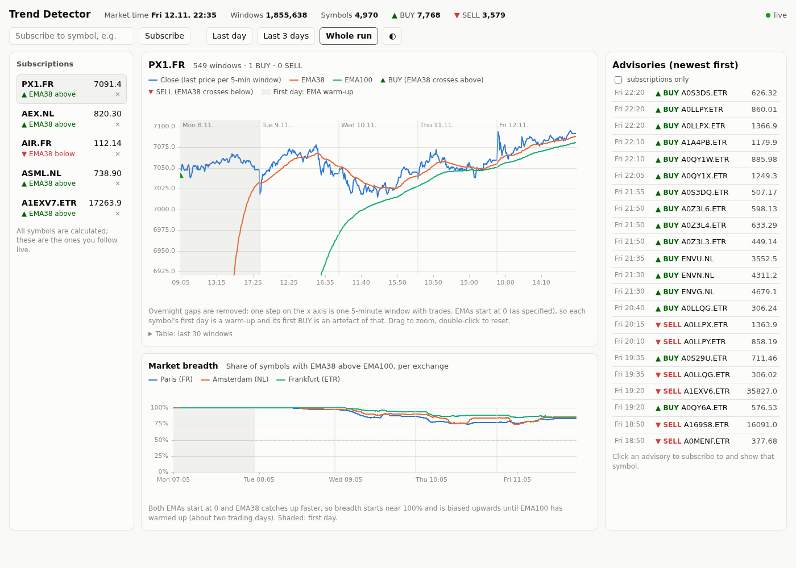
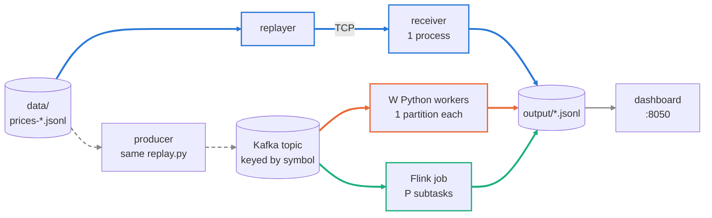

# Trading Trend Detector

[](https://www.python.org/)
[](docker-compose.yml)
[](docs/pipelines.md#kafka-pipeline)
[](docs/pipelines.md#flink-pipeline)
Detecting trading trends in a week of European tick data, as a stream.
Course project for CS-E4780 Scalable Systems and Data Management at Aalto University.

For every symbol, the pipeline cuts the price stream into 5-minute windows, tracks two
exponential moving averages (EMA38 and EMA100, query 1) and emits a **BUY** or **SELL**
advisory when they cross (query 2). A live dashboard shows it happening.





## Quick start

1. Download the weekday CSVs from [Zenodo](https://doi.org/10.5281/zenodo.6382482) into `data/`.
2. Extract the price events once (much faster to replay than the CSV):

   ```bash
   for f in data/debs2022-gc-trading-day-*.csv; do d=${f#*day-}; d=${d%.csv}
       python3 replayer/replay.py "$f" --speed 0 --only-prices --no-stamp --progress 0 > data/prices-$d.jsonl
   done
   ```

3. Run it and open **http://localhost:8050**:

   ```bash
   docker compose up --build
   ```

This replays the whole week at 60x speed with the nights shortened to 10 minutes. Results
are written to `output/windows-<time>.jsonl`. To change the input, speed and so on, copy
[.env.example](.env.example) to `.env`. For example, only Monday as fast as possible:

```bash
REPLAY_FILES=/data/prices-08-11-21.jsonl
REPLAY_SPEED=0
```

## Pipelines

We built the same queries three ways (colors as in the diagram; dashed grey is the Kafka part shared by the last two):

| | Pipeline | Command |
| --- | --- | --- |
| 🔵 | **TCP**: one receiver process | `docker compose up --build` |
| 🟠 | **Kafka + W Python workers**, one partition each | `KAFKA_WORKERS=4 docker compose --profile kafka up --build` |
| 🟢 | **Kafka + Flink** (PyFlink) | `docker compose --profile flink run --rm flink` |

All three use the same window, EMA and advisory logic ([receiver/processor.py](receiver/processor.py)).
After a Kafka or Flink run, reset the broker with `docker compose --profile kafka down`.
Details: [docs/pipelines.md](docs/pipelines.md).

## Benchmarks

Throughput per pipeline, all on the same machine and the same input (unpaced):

| | Pipeline | Events/s |
| --- | --- | ---: |
| 🔵 | TCP | _TBD_ |
| 🟠 | Kafka + W Python workers | _TBD_ |
| 🟢 | Kafka + Flink | _TBD_ |

> [!NOTE]
> Still to do before filling in the table:
> - [ ] Run all three pipelines on the same machine (specs recorded), with the same input
> - [ ] Same settings everywhere: unpaced, JSONL input, same Docker CPU and memory limits
> - [ ] Scale 1 / 2 / 4 / 8 workers (Kafka) and parallelism (Flink), several runs each, mean ± std
> - [ ] Check every run's output against the TCP baseline (`bench/compare_outputs.py`)
> - [ ] Paced runs for latency (p50/p95/p99), separate from the throughput runs

Run a benchmark unpaced, with a label and without the dashboard:

```bash
REPLAY_SPEED=0 BENCH_LABEL=week-tcp docker compose up --build receiver replayer
```

Each run writes its numbers (throughput, CPU, memory, latency) to its own folder in
[results/benchmarks/](results/benchmarks/). See [docs/benchmarking.md](docs/benchmarking.md)
for what they mean and how to benchmark the processor alone.

## Repository

| Path | |
| --- | --- |
| [replayer/](replayer/) | Replays the data as a paced event stream (TCP or Kafka) |
| [receiver/](receiver/) | TCP receiver, the stream processor and the Kafka workers |
| [flink/](flink/) | PyFlink job |
| [dashboard/](dashboard/) | Live dashboard (no dependencies, uPlot in the browser) |
| [bench/](bench/) | Benchmark and correctness-check scripts |
| [tests/](tests/) | Unit tests: `python3 -m unittest discover -s tests` |
| [docs/](docs/) | [Pipelines](docs/pipelines.md), [benchmarking](docs/benchmarking.md), [working log](docs/working_log.md) |
