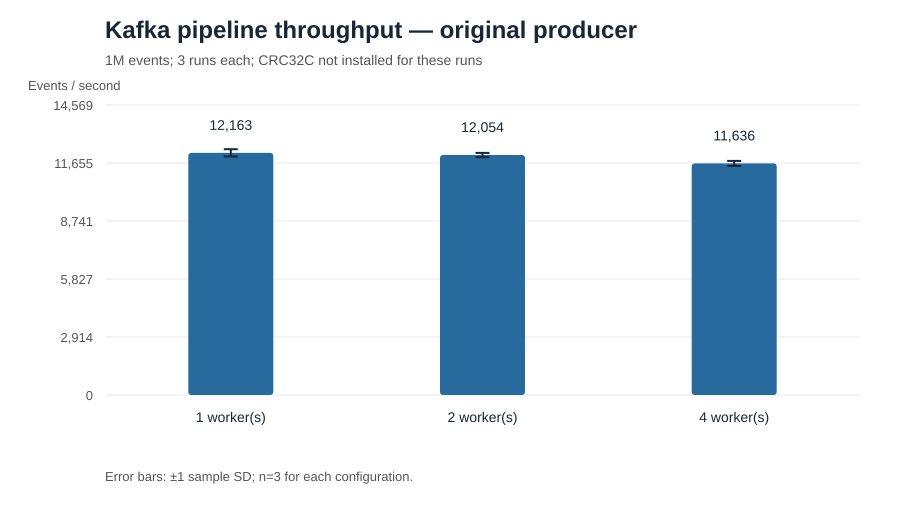
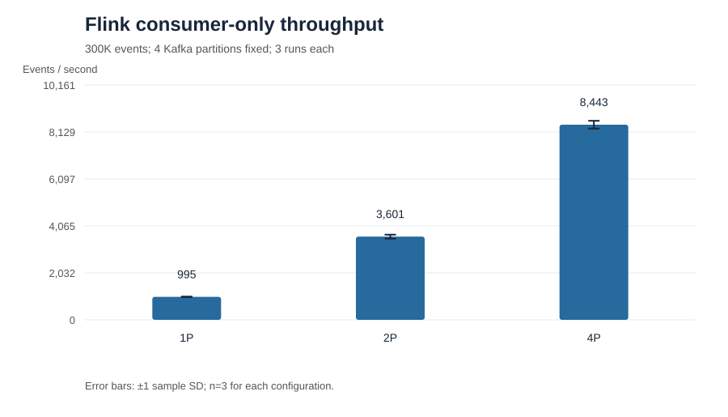
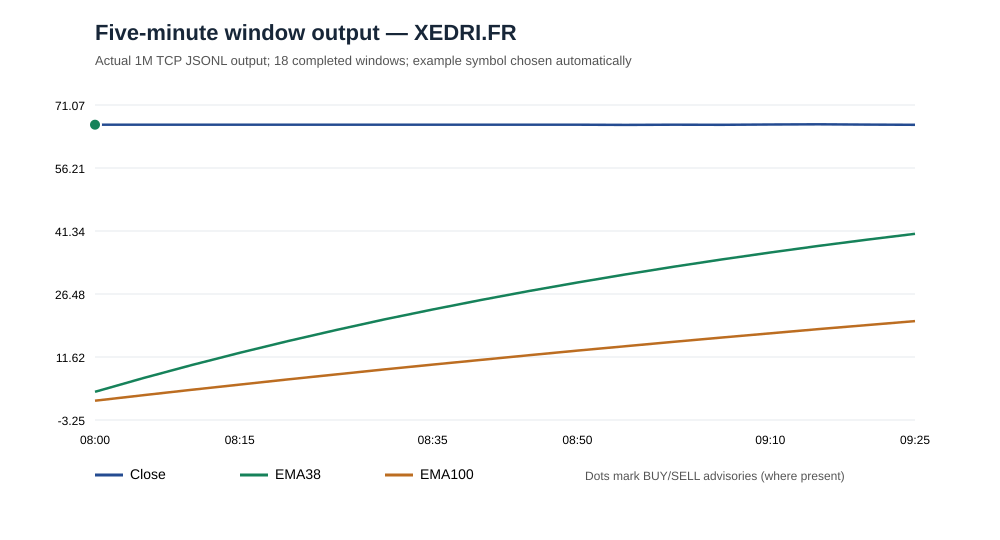

# Performance evaluation and reproducibility notes (8 November 2026)

## Environment and data

- Project: CS-E4780 trading-trend-detector; local Docker Desktop/WSL2 experiments on Windows.
- Observed Docker runtime: 16 logical CPUs; 8,250,089,472 bytes (~7.68 GiB) available memory. No explicit container CPU quota, memory limit or pinned CPU set were configured in the inspected Flink container. These are **environment observations**, not proof that every run used an identical effective CPU allocation.
- Input: pre-extracted `data/prices-300k.jsonl` and `data/prices-1m.jsonl` (DEBS 2022, Monday 8 November 2021); unpaced replay, starting from 08:00. The raw dataset is not committed.
- Scope: 5-minute event-time windows, EMA38/EMA100, BUY/SELL crossover advisories. See the code and source JSON records for exact parsing/validation parameters.
- Source summaries: `results/benchmarks/kafka_scalability_summary.csv` and `results/benchmarks/flink_scalability_300k_4part_summary.csv`.
- Raw selected run records including original run labels and host/config fields: `results/benchmarks/review_evidence_2026-11-08.json` (selected counts: {'kafka_original': 18, 'flink_300k_fixed4': 9, 'kafka_crc32c_1m': 1, 'flink_1m': 1}).

## Kafka pipeline scalability — before CRC32C

| Dataset | Workers | Runs | Mean events/s | Sample SD | Mean p95 ms | Worker RSS total MB |
|---|---:|---:|---:|---:|---:|---:|
| 1m | 1 | 3 | 12,162.78 | 183.52 | 147.69 | 31.17 |
| 1m | 2 | 3 | 12,054.46 | 108.62 | 92.56 | 56.55 |
| 1m | 4 | 3 | 11,635.80 | 125.97 | 60.74 | 108.61 |
| 300k | 1 | 3 | 11,991.60 | 441.87 | 78.12 | 28.76 |
| 300k | 2 | 3 | 12,027.09 | 65.88 | 49.22 | 55.33 |
| 300k | 4 | 3 | 11,592.52 | 104.58 | 40.88 | 107.33 |

**Measurement definition:** Kafka Workers process events while the Kafka Producer publishes. Overall `events_per_second` is the total events divided by the interval from the earliest worker event to the latest worker event. As such, it includes waiting for producer throughput and backpressure; it excludes startup. The measured latency is send timestamp on the event finalizing a window to flushed output, not a universal per-event end-to-end latency. Worker RSS excludes Kafka broker and Producer memory.

**Interpretation:** The original pipeline stays near 12K events/s across 1, 2 and 4 workers, which suggests a bottleneck outside the workers. A separate producer-only run was ~12,406 events/s (1M events; 1 partition). CPU profiling found significant time spent in CRC32C. Installing native `crc32c==2.9.post0` increased the producer-only run to ~20,371 events/s and a **single** optimized Kafka 1-worker run to ~20,078 events/s, versus a baseline 1-worker mean of ~12,163 events/s (about +65.1%). No optimized 2/4-worker repetitions have been run, so do not extrapolate that result to scaling.

## Flink window-operator scaling — 4 Kafka partitions fixed

| Window parallelism | Runs | Mean events/s | Sample SD | Observed speedup | Python CPU s | Python RSS total MB |
|---:|---:|---:|---:|---:|---:|---:|
| 1 | 3 | 995.18 | 11.87 | 1.00 | 455.53 | 722.15 |
| 2 | 3 | 3,600.73 | 86.26 | 3.62 | 230.01 | 723.28 |
| 4 | 3 | 8,443.20 | 168.19 | 8.48 | 168.37 | 727.85 |

**Measurement definition:** The Flink job is started **after** the Producer has finished filling a bounded Kafka topic. `active_seconds` is measured from the earliest ParseFunction event to the last WindowFunction activity, excluding job startup. The reported CPU and memory sum only Flink Python worker processes, not JVM memory or the Kafka broker. This is **consumer-only**, so these rates must not be compared directly with Kafka pipeline end-to-end rates.

**Interpretation:** With 4 Kafka partitions fixed, Flink shows a reproducible throughput increase as Window Parallelism rises: observed 4P/1P speedup is 8.48x, an unusually superlinear observation. That is not established computational parallel efficiency; different operator bottlenecks, JVM/Python boundaries, buffering, backpressure and runtime overhead may contribute. Detailed profiling would be needed to isolate the mechanism. No explicit per-container CPU cap was used.

## Correctness and constraints

- All 41 Python unit tests passed (`results/benchmarks/unit_tests_final.txt`).
- TCP, Kafka Workers, and Flink output comparisons on the 1M-event pre-extracted input matched 30,386 completed windows: 0 missing, 0 different, 0 extra. Flink's 300K 1P/2P/4P representative runs matched 14,856 TCP windows.
- Flink 1M 4P consumer-only trial: ~8,192.92 events/s, 30,386 output windows, 0 late events; this is a single run, not a repeated-study mean.
- Original CSV and extracted JSONL replay may differ materially in parsing overhead; compare systems only when data input and timing boundaries agree.

## Example query results

Illustrative symbol: `XEDRI.FR` with 18 complete five-minute windows; auto-selected from the 1M TCP output.

### Next checks suggested by code review

1. Repeat optimized Kafka Producer+Workers for 1/2/4 workers under the same input and recording protocol; measure producer, worker and broker CPU separately.
2. Test native CRC32C on Kafka consumer separately before changing `receiver/requirements.txt`.
3. Record actual per-container Docker CPU and memory usage over time; consider explicitly capped CPU resources to evaluate throughput versus CPU budget.
4. Add raw run records and the visualizations to the PR; have teammates review any changed resource assumptions and compare-method definitions.
